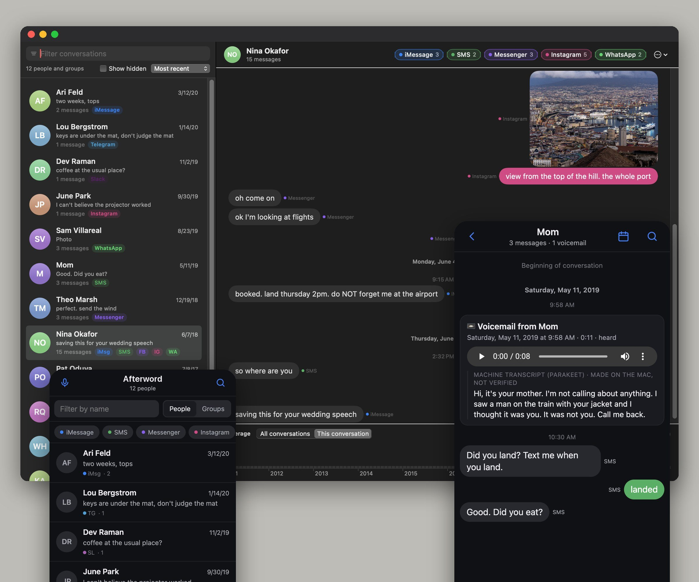

<p align="center"></p>

# Afterword

[](LICENSE)

Years of conversations are scattered across services, some still running and some long gone. Afterword rebuilds them from the exports and backups you already have into one archive on your own disk: iMessage, SMS, Messenger, Instagram, WhatsApp, Telegram, Slack, Snapchat, GroupMe, Skype, AIM, voicemail and more, with each person's messages merged into one timeline. You own it, it never leaves your machine, and a Mac app and a small web viewer let you read it.

*The image shows invented people and messages.*

## What it does

- **Reads the services that died, not just the living ones.** Besides iPhone backups (back to iOS 5), the Mac's own Messages database, Android SMS exports and Meta's Messenger and Instagram exports, it reads formats few tools touch: iChat and AIM transcripts, Skype 5's `main.db`, Telegram for macOS, the Slack desktop app's cached state (no export needed), Snapchat and GroupMe exports, WhatsApp's iPhone database and the 2011-era Facebook download.
- **One person, one timeline.** Phone numbers, email addresses, Messenger names, Instagram users and Slack accounts are matched into people automatically and cautiously. A small review page suggests further merges, and every correction is yours and can be undone.
- **More than texts.** Call logs, voicemails and voice memos (with transcripts you make with any speech-to-text tool), voice messages, Facebook and Instagram posts and comments, Apple Notes and Calendar events sit beside the messages. Last.fm listening history can be imported too (stored, not yet shown).
- **Two ways to read it.** A native SwiftUI Mac app, and a read-only web viewer (`archivectl serve-web`) that also works in a phone's browser. Both search messages, posts and recording transcripts, show photos and play voicemails and voice memos; the web viewer also plays video inline.
- **Careful with your data.** Every import is recorded with its file's SHA-256; importing the same file again adds nothing; most importers can run add-only and write a ledger line per row; `archivectl verify` checks the database, its search indexes and every media file. Attachments are stored by content hash inside the archive folder, so the whole folder can be copied anywhere and opened unchanged.
- **No dependencies.** Swift and the system SQLite. The web viewer is plain HTML, CSS and JavaScript with no build step.

## Quick start

You need macOS 14 or later with the Xcode Command Line Tools (`xcode-select --install`; Swift 6).

```sh
git clone https://github.com/milesshebar/afterword.git
cd afterword
swift build -c release

# a clearly fake archive to try it on (invented people, 555-01xx numbers, generated pictures)
.build/release/archivectl demo-seed /tmp/demo-archive --scale 0.05
.build/release/archivectl --archive /tmp/demo-archive stats

# read it in the Mac app ...
.build/release/Afterword --archive /tmp/demo-archive

# ... or in the web viewer, at http://127.0.0.1:8452/
.build/release/archivectl --archive /tmp/demo-archive serve-web
```

To make a real app bundle in `build/Afterword.app`, run `scripts/bundle.sh`. It signs ad hoc unless you name a code-signing certificate in `SIGN_IDENTITY` (a self-signed one is fine; it never picks one from your keychain on its own). With ad-hoc signing, macOS may ask for the Contacts permission again after each rebuild. The bundle identifier comes from `scripts/product.env` (`BUNDLE_ID`). `--scale 1` on `demo-seed` makes a 31,000-message thread for performance checks.

## Supported sources

| Source | What to point it at | Command |
|---|---|---|
| iMessage / SMS (Mac) | a snapshot of `~/Library/Messages/chat.db` | `import` |
| iPhone backups (iOS 5 to current) | an unencrypted Finder/iTunes backup folder, or a decrypted extract (`scripts/iphone-backup-stage.py`) | `import` |
| Android SMS / MMS | SMS Backup & Restore `sms-*.xml` (streamed; gigabyte files are fine) | `import` |
| Facebook Messenger, Instagram DMs | Meta "Download your information" HTML export | `import` |
| Facebook 2011 export | the old `html/messages.html` export (experimental, see below) | `fb-dyi-2011-import` |
| Facebook / Instagram posts and comments | records written by `scripts/posts_read.py` | `posts-import` |
| WhatsApp | `ChatStorage.sqlite` from an iPhone backup | `import` |
| GroupMe | the account-data export, unzipped | `import`, `groupme-media` |
| Snapchat | the "My Data" export, unzipped | `import` |
| Skype | a Skype 5 for Mac `main.db` | `import` |
| iChat / AIM | saved `.ichat` transcripts | `ichat-import` |
| Telegram | Telegram for macOS `postbox/db/db_sqlite` (unencrypted, older versions) | `telegram-import` |
| Slack | the desktop app's `IndexedDB` folder (and its cache for files) | `slack-import`, `slack-files-*` |
| Calls | a `calls.tsv` you assemble from phone, Mac, WhatsApp and Skype logs (columns in `Sources/ArchiveCore/CallImporter.swift`) | `calls-import` |
| Voicemails, voice memos, recorded meetings | a `recordings.tsv` plan plus machine transcripts | `recordings-import` |
| Notes, Calendar, Contacts | iPhone backup databases or a Mac's own stores | `notes-import`, `calendar-import`, `iphone-contacts`, `contacts` |
| Last.fm scrobbles | a folder written by `scripts/lastfm-pull.py` | `import` |

`archivectl` with no arguments prints every command and option.

## Requirements

- macOS 14 or later, with the Xcode Command Line Tools and Swift 6 (`xcode-select --install`; tested with Swift 6.4). Xcode itself is not needed.
- For the helper scripts: Python 3.9 or later (standard library only, except `aup3-export.py`, which needs `numpy`, and `iphone-backup-stage.py`, which needs `iphone_backup_decrypt`). Node 18 or later only to run the web app's tests.
- For the web app in a container: Docker. The command-line tool and web app also build on Linux (`swift:6.3` images); the Mac app is macOS only.

## Your own archive

The archive lives in `~/Library/Application Support/Afterword` unless you pass `--archive <folder>` or set `AFTERWORD_ROOT`. Back up your sources first; the importers only ever read them, but keep the originals anyway.

```sh
# Messages on this Mac: snapshot chat.db first (never import the live file)
sqlite3 ~/Library/Messages/chat.db ".backup /tmp/chat-snapshot.db"
.build/release/archivectl import /tmp/chat-snapshot.db

# an unencrypted iPhone backup, an Android XML export and a Meta export in one go
.build/release/archivectl import ~/Library/Application\ Support/MobileSync/Backup/<id> ~/Downloads/sms-20200101.xml ~/Downloads/facebook-export

.build/release/archivectl stats
.build/release/archivectl people list
.build/release/archivectl verify
```

Imports are idempotent: importing the same file again reports it as already imported. A later `chat.db` snapshot adds only what came after the previous cutoff. Day-sized options (`--until`, `--since`) are read in this Mac's time zone, or in `AFTERWORD_TIME_ZONE` if you set it.

When the same call or recording turns up in several logs, one copy wins and the others are linked to it. The winner follows the log's label: calls rank `phone-*`, `mac-*`, `android-xml`, `whatsapp-app`, `skype-*`, then the Messenger, Instagram and GroupMe lines (newer year first within a prefix; `late-<label>` for a log added after the table was built); recordings rank `memo-voicememos-*`, `vm-phone-*`, `memo-phone-*`. If your labels follow another scheme, list them in a JSON file and point `AFTERWORD_SOURCE_PRIORITY` at it: `{"calls": [...], "calls_added_later": [...], "recordings": [...]}`, each key optional, earlier entries winning (`Sources/ArchiveCore/SourcePriority.swift`). Every import re-links the whole table, so keep the file the same from one import to the next.

Then open the archive in the Mac app (`build/Afterword.app`, or the binary with `--archive`). The app reads the archive and never writes it; people corrections go to `people.sqlite` beside it.

### Matching people

`archivectl people match` runs the automatic matching (every import also does). `archivectl serve` starts the review site on `http://127.0.0.1:8097/`: a mobile-friendly page that shows one suggested merge at a time (names, nicknames, username shapes, shared group chats) with yes / no / skip and undo. Nothing is merged without your answer.

### The web viewer

```sh
.build/release/archivectl --archive <folder> serve-web
```

serves the read-only web app on `http://127.0.0.1:8452/`: people, merged timelines, group threads, search, posts, recordings, media with HTTP Range and generated thumbnails (ImageIO on a Mac; `vipsthumbnail` from libvips on Linux, included in the container). On its own it answers only this machine.

**Reaching it from other devices.** The web app does not log anyone in. Whatever sits in front of it must authenticate every person who uses it, and only people you would hand the whole archive to should pass. Use one of:

- **Tailscale.** Keep the server on loopback and let `tailscale serve` put it on your tailnet; Tailscale tells the server who is asking, and only the logins you list get in:

  ```sh
  archivectl --archive <folder> serve-web --allow-host <this machine's Tailscale DNS name> --allow-login you@example.com
  tailscale serve --bg 8452
  ```

- **A reverse proxy that authenticates users** (basic auth, an SSO / forward-auth layer, or a listener reachable only over your VPN). The proxy's own authentication is what protects the archive. It also sends a shared key, `X-Archive-Key`, which matters only when the proxy runs on **another machine**: there the server demands it from every non-loopback peer, so the rest of the network cannot bypass the proxy. The key is not a login; it proves only that a request came through the proxy. On the **same machine** the key separates nothing: the server trusts every loopback connection, so any local user or process can reach `127.0.0.1:8452` directly and skip the proxy's authentication. Run it that way only on a machine whose users you would trust with the archive. A complete Caddy example, with the server on the same machine:

  ```caddyfile
  archive.example.org {
      basic_auth {
          # caddy hash-password  -> paste the hash here
          you $2a$14$REPLACE_WITH_THE_HASH
      }
      reverse_proxy 127.0.0.1:8452 {
          header_up X-Archive-Key {env.ARCHIVE_WEB_KEY}
      }
  }
  ```

  ```sh
  export ARCHIVE_WEB_KEY="$(openssl rand -hex 24)"     # the same value in the server's and Caddy's environment
  archivectl --archive <folder> serve-web --allow-host archive.example.org
  ```

Never put a proxy in front that only adds the key and does not authenticate people: everyone who can reach the proxy would get the whole archive.

The server refuses to start with a gate that would let strangers in: any `--bind` other than `127.0.0.1` needs `ARCHIVE_WEB_KEY` (at least 24 characters, not the example placeholder) plus `--allow-peer` or `--any-peer`; `--allow-login` works only on a loopback bind, because elsewhere the login header is whatever the client sends; `--allow-host` on loopback needs a key or `--allow-login` (a guard against forgetting the proxy's settings; on loopback the key itself is not checked). Every request from a non-loopback peer must carry the key. See [SECURITY.md](SECURITY.md).

**The container** runs the same server for a proxy on another machine. Copy `secrets/app.env.example` to `secrets/app.env` and set `ARCHIVE_WEB_KEY` (`openssl rand -hex 24`), then

```sh
ARCHIVE_DIR=/path/to/archive ARCHIVE_WEB_HOSTS=archive.example.org docker compose up -d --build
```

The container runs as uid 1000, so the archive folder must be readable by that uid (`chmod -R o+rX` it, or give uid 1000 read access); thumbnails go in a named volume. It mounts the archive read-only and publishes port 8452 on `127.0.0.1` only: point your authenticating proxy at it (change the port mapping only if the proxy runs on another machine, and then firewall the port to that machine).

### GroupMe media

A GroupMe export carries only a few files; every other image is a URL in the message text. `archivectl groupme-media <folder>` attaches files you have downloaded yourself (fetch slowly). The folder holds the files, named by their SHA-256, and a `results.jsonl` with one JSON object per URL: `url`, `status` (`ok`, `gone` or `failed`), `ctype` (the Content-Type), `bytes`, `sha256` and `file` (the file name in the folder). Each `ok` file is checked, stored in the media store and attached to every message that carried its URL, and the URL line is removed from the message text.

## Security

The archive is plain SQLite plus files, so anyone who can read the folder can read your messages: keep it on an encrypted disk. Nothing in this project makes a network request except the web viewer (only where you run it), `scripts/lastfm-pull.py` (Last.fm's API, with your own key) and the Mac app's optional self-updater, which is **off** unless you set an https update server (`defaults write <bundle id> updateServer <url>` or `AFTERWORD_UPDATE_SERVER`). The web viewer has no logins: it answers only this machine unless you put an authenticating layer in front of it (see "Reaching it from other devices"), and it serves attachments so they can never act as the viewer. Several commands print names and message text (`people show`, `posts`, `suggest --cards`); others print counts only, so be careful where you paste their output. The full trust model is in [SECURITY.md](SECURITY.md).

## Limits

- Phone numbers are normalized US-first: 10 digits, or 11 with a leading 1, become `+1...`; numbers with an explicit `+` or international prefix are kept as written. Archives of mostly non-US local numbers will match people less well.
- Messages attachments that macOS has offloaded to iCloud are not fetched; they are noted on the message and can be attached later (`attachments-backfill`) once Messages downloads them.
- Encrypted iPhone backups must be decrypted first (`scripts/iphone-backup-stage.py`).
- The Facebook 2011 importer has been checked against one real export only, so it runs only with `--allow-unverified-file`; run it with `--dry-run` first and read its ledger. That export prints times with no zone: they are read in `--zone` (default this machine's zone). The one export checked matched a fixed offset (UTC-04:00, no daylight saving) better than its named zone, so compare dry runs with your zone's name and with its fixed offset. `scripts/posts_read.py fb2011` requires `--zone` for the same reason.
- `posts-media` (attaching post photos from a media plan, optionally linked to a PhotoPrism library) expects a plan you build yourself; its columns are in `Sources/ArchiveCore/PostsMedia.swift`.
- Instagram exports print times with no zone; they are read as a fixed UTC-08:00, which matched every export checked.
- Transcription is not built in: voicemail and voice-memo transcripts are imported from JSON files you produce with any speech-to-text tool.
- The Mac app is distributed as source only; there is no notarized build.

## Scripts

| Script | Purpose |
|---|---|
| `scripts/bundle.sh` | build and sign `build/<name>.app` |
| `scripts/release-app.sh DEST` | publish a signed build for the optional self-updater |
| `scripts/install-app.sh [HOST]` | install a signed build in `~/Applications`, here or over SSH |
| `scripts/selfcheck.sh [outdir] [scale]` | seed a demo archive and render the app's main views to PNGs, with timings |
| `scripts/posts_read.py` | read Facebook (saved pages, 2011 export, current export) and Instagram posts and comments into a records file for `posts-import` |
| `scripts/posts_invariants.py` | independent audit of a `posts-import` run against the archive it was copied from |
| `scripts/fb_saved_pages.py` | parser for Facebook pages saved from a browser and the 2011 export (used by `posts_read.py`) |
| `scripts/iphone-backup-stage.py` | decrypt an encrypted iPhone backup read-only and stage its message-related databases |
| `scripts/lastfm-pull.py` | slowly pull a Last.fm user's scrobble history for `import` (needs `LASTFM_API_KEY`) |
| `scripts/aup3-export.py` | export an Audacity 3 project's tracks to WAV without Audacity |

## Tests

```sh
swift test                                              # the Swift tests (Swift Testing)
for t in scripts/test_*.py; do python3 -I -B "$t"; done  # the Python readers
for t in scripts/test_web_*.mjs; do node "$t"; done       # the web app's pure helpers
```

Every fixture is synthetic: invented names, `555-01xx` numbers, `example.com` addresses.

## Layout

```
Sources/ArchiveCore   the library: schema, importers, person matching, readers, web and review servers
Sources/archivectl    the command-line tool
Sources/ArchiveApp    the SwiftUI Mac app (product name from Package.swift)
Sources/CSQLite       the system SQLite module map for Linux
Tests/                Swift tests
web/                  the web app's static page
scripts/              helpers and their tests
```

## Not affiliated

This project is not affiliated with, endorsed by or sponsored by Apple, Meta, WhatsApp, Slack, Microsoft (Skype), Telegram, GroupMe, Snap, Last.fm or any other service whose data it reads. Their names are used only to say which formats it reads.

## License

MIT, see [LICENSE](LICENSE). Written by Miles Shebar.
